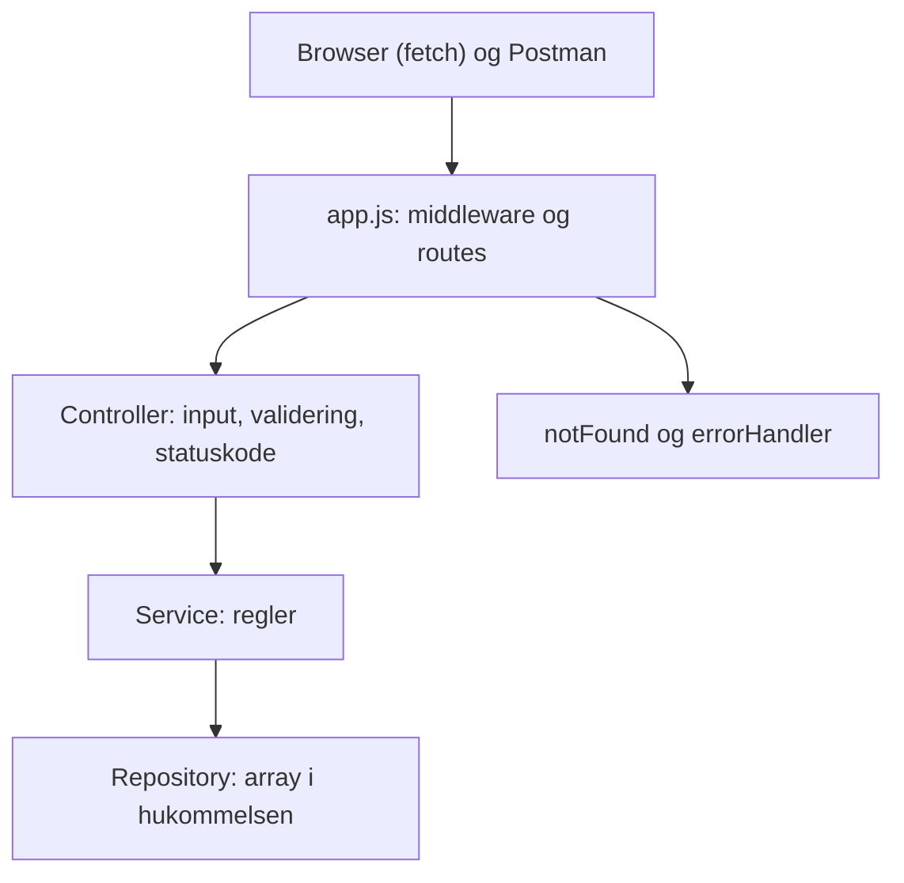

# Star Wars API (Jedi Data Archives)

## Hvad laver programmet?

En Express server med et REST API, der kan oprette, hente, erstatte og slette Star Wars karakterer, og en simpel hjemmeside, der henter og viser dem med `fetch()`. Karaktererne ligger i en array i hukommelsen, så de forsvinder, når serveren genstartes.

## Kom i gang

```bash
npm install
npm start
```

Åbn derefter `http://localhost:3000` i browseren. Kør tests og lint med `npm run check`.

## API

Udfyldes, efterhånden som endpoints bliver lavet.

* GET `/characters`: hent alle
* GET `/characters/:id`: hent én
* POST `/characters`: opret
* PUT `/characters/:id`: erstat
* DELETE `/characters/:id`: slet
* GET `/download` og GET `/go-to-luke`

## Struktur

* `public/`: frontend (HTML og JavaScript, Bootstrap fra CDN)
* `src/app.js`: samler middleware og routes (`createApp`)
* `src/server.js`: opretter repository og starter serveren på port 3000
* `src/controllers/`: læser request, validerer input og vælger statuskode
* `src/services/`: regler for karakterer
* `src/repositories/`: gemmer karaktererne i en array
* `src/middleware/`: logging, 404 og fejlhåndtering
* `tests/`: automatiske tests
* `postman/`: eksporteret Postman Collection

Flere regler står i [AGENTS.md](AGENTS.md), test reglerne i [docs/unit-test-guide.md](docs/unit-test-guide.md), og en guide til opsætningen i [docs/setup-guide.md](docs/setup-guide.md).

## Arkitektur (issue 1)



Rækkefølgen i `app.js`: logger, `express.json()`, `express.static`, routes under `/characters`, `notFound`, `errorHandler`.

### Svar på opgavens spørgsmål

* **Hvor håndteres HTTP requests?** I controlleren. Den læser `req`, tjekker input og vælger statuskode. `app.js` kobler URL og metode til de rigtige funktioner.
* **Hvor gemmes karakterdata?** I repositoryet, i en array i hukommelsen.
* **Hvor placeres valideringen?** I controlleren, i funktionen `validateCharacter`. Det er input fra HTTP, og det giver 400. Så kan servicen regne med, at data er gyldigt.
* **Fordele:** Hvert lag har ét ansvar. Lagene kan testes hver for sig. Repositoryet kan skiftes til en fil eller en database uden at ændre service og controller. Strukturen kender vi fra To Do Taming.
* **Ulemper:** Til en lille opgave er servicen tynd og gør ikke meget mere end at give data videre og finde en karakter. Der er flere filer, end der strengt taget er brug for. Validering i controlleren kan ikke genbruges, hvis der kommer en anden indgang end HTTP. Karaktererne forsvinder, når serveren genstartes.

### Ansvarsfordeling

* `app.js`: samler middleware og routes
* Controller: HTTP, input, validering, statuskode og logning af fejl
* Service: reglerne (find karakter, giv besked, hvis den ikke findes)
* Repository: den eneste, der kender arrayet
* Middleware: logning, 404 og central fejlhåndtering

### Hvad fungerer godt

Det er nemt at se, hvor noget hører til, og tests kan bruge et nyt repository hver gang.

### Hvad vi ville ændre, hvis projektet voksede

Gemme data i en database, så kun repositoryet skal ændres. Tilføje login og rettigheder. Dele routes ud i egen mappe, hvis der kommer flere ressourcer end karakterer.

### Beslutninger

1. **Id'er:** tælleren ligger i repositoryet, og `add` giver id'et i én operation. Servicen læser ikke først alle karakterer for at finde et nyt id. Det samme gælder PUT og DELETE: de er én operation i repositoryet.
2. **Sprog i fejlbeskeder:** engelsk i API'et, dansk i frontenden.
3. **Validering:** en funktion `validateCharacter` i controlleren.

## Mit stykke (skriv under dit eget navn)

Hver skriver sit eget afsnit her i sin pull request: hvad blev lavet, hvilke fejl fandt jeg, og svar på de "undersøg" spørgsmål, der hører til mit issue.

### Nicki

### Gon

### Mat

## Tests

Kort beskrivelse af de tests, der er lavet.

## Kode review (issue 8)

* Tre forbedringsforslag og hvilken vi gennemførte
* AI review: hvilke forslag accepterede vi, hvilke afviste vi, og hvorfor

## Refleksionsspørgsmål

### 1. Hvilken arkitektur har I valgt, og hvorfor?

### 2. Hvad ville I ændre, hvis applikationen skulle bruges af mange brugere?

### 3. Hvilke fejl fandt I under udvikling og test?

### 4. Hvilken forbedring gennemførte I efter kode review?

### 5. Hvad lærte I om samspillet mellem frontend og backend?
