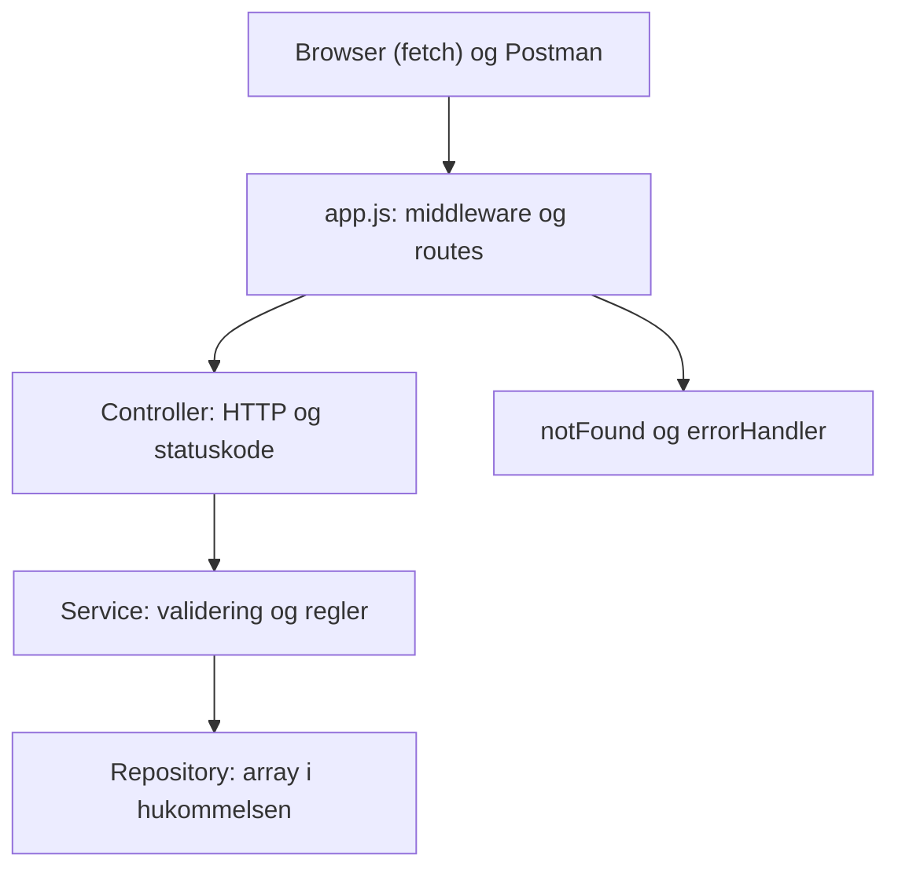

# Star Wars API (Jedi Data Archives)


## Hvad laver programmet?

En Express server med et REST API, der kan oprette, hente, erstatte og slette Star Wars karakterer, og en simpel hjemmeside, der henter og viser dem med `fetch()`. Karaktererne ligger i en array i hukommelsen, så de forsvinder, når serveren genstartes.

## Kom i gang

```bash
npm install
npm start
```

Åbn derefter `http://localhost:3000` i browseren. Kør tests og lint med `npm run check`.

## API

Karakter-endpoints svarer med JSON. `/download` sender en tekstfil, `/go-to-luke` svarer med en redirect til Luke Skywalkers karakter-id, og `/` serverer frontendens HTML-side. Hvis Luke ikke findes, svarer endpointet med 404. API-fejl har formen `{ "error": "..." }`, og fejlbeskederne er på engelsk.

| Metode og URL | Body | Svar |
| --- | --- | --- |
| GET `/characters` | | 200 med et array af karakterer |
| GET `/characters/:id` | | 200 med karakteren, 404 hvis id'et ikke findes |
| POST `/characters` | `{ name, role, planet }` | 201 med den nye karakter (serveren vælger id), 400 ved ugyldigt input |
| PUT `/characters/:id` | `{ name, role, planet }` | 200 med den erstattede karakter, 400 ved ugyldigt input, 404 hvis id'et ikke findes |
| DELETE `/characters/:id` | | 204 uden body, 404 hvis id'et ikke findes |
| GET `/download` | | 200, tekstfilen `characters.txt` |
| GET `/go-to-luke` | | 302 redirect til Luke Skywalkers `/characters/:id`, 404 hvis Luke ikke findes |

Gyldigt input: `name` er tekst med mindst 2 tegn efter trim, `role` er Jedi, Sith, Rebel eller Smuggler, og `planet` er tekst og ikke tom.

Andre fejl: ukendt route giver 404 `{ "error": "Route not found" }`, ugyldig JSON giver 400 `{ "error": "Invalid JSON" }`, og uventede fejl giver 500 `{ "error": "Internal server error" }`.

## Struktur

* `public/`: frontend (HTML og JavaScript, Bootstrap fra CDN)
* `src/app.js`: samler middleware og routes (`createApp`)
* `src/server.js`: opretter repository og starter serveren på port 3000
* `src/controllers/`: læser request og response og vælger statuskode
* `src/services/`: validerer karakterer og håndterer forretningsregler
* `src/repositories/`: gemmer karaktererne i en array
* `src/middleware/`: logging, 404 og fejlhåndtering
* `tests/`: automatiske tests
* `postman/`: eksporteret Postman Collection

Flere regler står i [AGENTS.md](AGENTS.md), test reglerne i [docs/unit-test-guide.md](docs/unit-test-guide.md), og en guide til opsætningen i [docs/setup-guide.md](docs/setup-guide.md).

## Arkitektur (issue 1)



Rækkefølgen i `app.js`: logger, `express.json()`, `express.static`, routes under `/characters`, `notFound`, `errorHandler`.

### Svar på opgavens spørgsmål

* **Hvor håndteres HTTP requests?** I controlleren. Den læser `req` og `res` og vælger statuskode. `app.js` kobler URL og metode til de rigtige funktioner.
* **Hvor gemmes karakterdata?** I repositoryet, i en array i hukommelsen.
* **Hvor placeres valideringen?** I servicen, i funktionen `validateCharacter`. Servicen afviser ugyldigt input med en valideringsfejl, og controlleren oversætter den til HTTP 400.
* **Fordele:** Hvert lag har ét ansvar. Lagene kan testes hver for sig. Repositoryet kan skiftes til en fil eller en database uden at ændre service og controller. Strukturen kender vi fra To Do Taming.
* **Ulemper:** Til en lille opgave er servicen stadig enkel. Der er flere filer, end der strengt taget er brug for. Karaktererne forsvinder, når serveren genstartes.

### Ansvarsfordeling

* `app.js`: samler middleware og routes
* Controller: HTTP, statuskode og logning af fejl
* Service: validering og reglerne (find karakter, rens og opret, erstat, slet). `toCleanCharacter` trimmer tekst og kopierer kun de tre felter
* Repository: den eneste, der kender arrayet
* Middleware: logning, 404 og central fejlhåndtering

### Hvad fungerer godt

Det er nemt at se, hvor noget hører til, og tests kan bruge et nyt repository hver gang.

### Hvad vi ville ændre, hvis projektet voksede

Gemme data i en database, så kun repositoryet skal ændres. Tilføje login og rettigheder. Dele routes ud i egen mappe, hvis der kommer flere ressourcer end karakterer.

### Beslutninger

1. **Id'er:** tælleren ligger i repositoryet, og `add` giver id'et i én operation. Servicen læser ikke først alle karakterer for at finde et nyt id. Det samme gælder PUT og DELETE: de er én operation i repositoryet.
2. **Sprog i fejlbeskeder:** engelsk i API'et, dansk i frontenden.
3. **Validering:** funktionen `validateCharacter` i servicen sikrer, at både direkte servicekald og HTTP-kald følger inputreglerne.

## Mit stykke (skriv under dit eget navn)

Hver skriver sit eget afsnit her i sin pull request: hvad blev lavet, hvilke fejl fandt jeg, og svar på de "undersøg" spørgsmål, der hører til mit issue.

### Nicki

**Issue 3: GET /characters/:id og karakterer i frontend**

Hvad jeg lavede:
* Repository: `getById` finder en karakter i arrayet
* Service: `getCharacterById` giver karakteren eller `null`
* Controller: `handleGetOne` laver id til tal og svarer 200, 404 eller 500
* Frontend: `loadCharacters()` henter `/characters` og viser en `<li>` pr. karakter
* Tests: repository og GET /characters/:id (200 og 404)

Fejl jeg fandt:
* `req.params.id` er tekst, så det skal laves til tal med `Number`, ellers finder man ingen karakter
* Jeg lavede ved en fejl funktioner til andre issues og fjernede dem igen
* Lint klagede over en ubrugt variabel i en test

Undersøg (Network fanen):
* Metode og URL: GET `/characters`
* Status: 200
* Body: JSON array med `id`, `name`, `role` og `planet`
* JSON til elementer: `response.json()` giver et array, `map` laver en `<li>` pr. karakter, og `replaceChildren` sætter dem ind. Vi bruger `textContent`, ikke `innerHTML`.

**Issue 4: POST /characters, validering og formular**

Hvad jeg lavede:
* Service: `validateCharacter` tjekker navn (mindst 2 tegn), rolle (Jedi, Sith, Rebel eller Smuggler) og planet (ikke tom). Forkerte typer giver en valideringsfejl og crasher ikke. `createCharacter` afviser ugyldigt input, trimmer navn og planet og kopierer kun de tre felter, så klienten ikke selv kan vælge id
* Controller: oversætter service-lagets valideringsfejl til HTTP 400 og svarer 201 med den nye karakter ved gyldigt input
* Repository: `add` giver id'et med en tæller i én operation
* Frontend: formular med navn, rolle og planet. `createCharacter()` sender POST og viser serverens fejlbesked
* Tests: `validateCharacter`, `add` og POST /characters (201, trim, id fra klient ignoreres, 400)

Fejl jeg fandt:
* Mit første forslag til id var `Date.now()`, men to oprettelser i samme millisekund kan få samme id. Det blev til en tæller
* Valideringsfunktionerne lå først i controlleren. De blev flyttet til servicen, så valideringen også gælder ved direkte servicekald
* Min første `handleCreate` gav aldrig et svar ved gyldigt input, så requesten hang

Undersøg:
* Hvorfor er arrayets længde en dårlig id? Hvis man sletter en karakter, kan næste karakter få et id, der allerede har været brugt. Vi bruger en tæller (`nextId++`), som ikke afhænger af arrayets længde
* Hvad sker der ved genstart? Karaktererne ligger kun i hukommelsen, så ændringer nulstilles
* Ekstra eksperiment, `"name": 123`: `validateName` tjekker, at `name` er tekst, og serveren svarer 400 med "Name must be text". Den går ikke ned. Postman request 8 tester det, og request 10 viser, at data er uændret

**Issue 6: download og redirect**

Hvad jeg lavede:
* GET `/download` henter karaktererne med rollen `Rebel` (Rebel Alliance, som opgaven beskriver), skriver dem én linje pr. karakter til en midlertidig `characters.txt` og sender filen med `res.download()`. Den midlertidige mappe fjernes, når overførslen er afsluttet
* GET `/go-to-luke` finder Luke Skywalker gennem servicen og svarer med en redirect til hans `/characters/:id`; hvis han ikke findes, svarer endpointet 404
* Tests: download (200, filnavn, type og indhold), redirect (302 og `Location`) og manglende Luke (404)

Undersøg:
* `/download` skriver den genererede Rebel-tekst til en midlertidig `characters.txt` og sender den med `res.download()`. Den midlertidige mappe fjernes, når overførslen er afsluttet. `res.send()` sender en body, men angiver ikke i sig selv, at den skal downloades. `res.attachment()` sætter download-headeren, men sender ikke filen. `res.download()` sender en fil fra disken med download-headeren
* `res.redirect()` svarer med status 302 og en `Location` header, og browseren sender selv en ny GET til den adresse
* En request får kun ét svar. Download og redirect er to forskellige svar, og når det første er sendt, er forbindelsen færdig. Et andet svar giver fejlen `ERR_HTTP_HEADERS_SENT`

**Issue 7: Postman**

Hvad jeg lavede:
* En Postman Collection med 17 requests og 23 tests (`pm.test`), som kører mod den kørende server med `{{baseUrl}}`
* Dækker GET alle og én (200, 404), POST (201 og 400 for manglende navn, ugyldig rolle, manglende planet, tal som navn og ødelagt JSON), PUT og DELETE (200, 204, 404), ukendt route (404), `/download` (200) og `/go-to-luke` (redirect, ender på Luke)
* Request 10 tjekker, at ugyldige POST ikke ændrede data

Sådan kører man den:
* Start serveren med `npm start`, importér filen fra `postman/`, og kør den med Collection Runner. Genstart serveren før hver kørsel, så data er tilbage til de fire standardkarakterer
* Resultat: 23 af 23 tests bestået

### Gon
**Hvordan går en request gennem controller, service og repository?**

Når man sender f.eks. POST /characters med { "name": " Yoda ", "role": "Jedi", "planet": "Dagobah" }, matcher routeren URL og metode, og derefter kaldes handleCreate i controlleren. Controlleren kalder createCharacter i servicen, som først validerer data. Hvis data er ugyldigt, kaster servicen en valideringsfejl, som controlleren oversætter til HTTP 400; repositoryet bliver ikke kaldt. Ved gyldigt input trimmer servicen navn og planet og kopierer kun de tre felter. Derefter kaldes add i repositoryet, som giver karakteren et unikt id og gemmer den i arrayet. Resultatet returneres tilbage gennem service og controller, som svarer med status 201 og den oprettede karakter.

**Hvad gør validateCharacter?**

ValidateCharacter tjekker først om data er et objekt. Derefter bruger den validateName, validateRole og validatePlanet. Hvis felterne er gyldige, returnerer funktionen null. Hvis et felt er ugyldigt, returnerer den en fejlbesked, som servicen pakker ind i en valideringsfejl; controlleren oversætter den til status 400 for HTTP-kald.

**En ting jeg har haft svært ved:**

Jeg har haft svært ved at forstå hvordan man laver en request i Postman, og hvordan man bruger postman til at sende rigtig requests til serveren. 


### Mat

Issue 2:
Hvad jeg lavet:
middleware:
- Lavet errorHandler middleware således at når programmet køres og noget fejler for vi en fejlbesked.
- errorHandler håndterer fejl i Express, logger dem og sender passende HTTP-fejlbeskeder (400 ved ugyldig JSON og 500 ved serverfejl).
- lavet logger middleware således at vi kan se hvad der sker i vores program.
- logger hver HTTP-forespørgsels metode og URL i konsollen og sender derefter forespørgslen videre med next().
- lavet notFound middleware således at vi får en 404 fejl hvis vi prøver at tilgå en route der ikke findes.
- notFound giver en 404 fejl hvis routen ikke kan tilgås.
Tests:
- lavet derudover også api.tests som alle fire er grønne.
- Jeg testede midlertidigt uden next() med en lokal HTTP-request i stedet for Postman: requesten ventede, indtil klienten afbrød den, og nåede ikke routen. next() er sat tilbage.

Refleksion over 400,404,500:
-400: Bad request, serveren forstår ikke requesten, typisk fordi den er ugyldig. Vi bruger det, når JSON ikke kan parses.
-404: Not found, serveren kan ikke finde det, der efterspørges. i koden er det typisk fordi id'et ikke findes i arrayet. Vi bruger det, når en karakter ikke findes.
-500: Internal server error, serveren fejler, typisk fordi der er en fejl i koden. Vi bruger det, når der sker en uventet fejl.

Hvorfor skal serveren ikke returnere 500, blot fordi en karakter ikke findes?
404 betyder, at forespørgslen var gyldig, men ressourcen findes ikke. Det er et forventet udfald, som klienten selv kan rette ved at bruge et andet ID. 500 betyder, at serveren fejlede uventet, så hvis en manglende karakter gav 500, kunne klienten ikke skelne mellem en forkert ID og en reel serverfejl. Det ville også fylde overvågningen med falske alarmer, så de rigtige fejl blev svære at få øje på.

Issue 5:
Hvad jeg lavet:
-Repository: Tilføjet funktioner til at erstatte og slette karakterer efter ID.
-Service: Tilføjet håndtering af erstatning og sletning, hvor URL’ens ID bevares.
-Controller: Implementeret PUT med validering og svarene 200/400/404 samt DELETE med 204/404.

Tests:
lavet tests for PUT (200, 404, 400) og DELETE (204, 404). som alle er grønne.

Refleksion over hvad der sker med karakter når server genstartes:
Karaktererne ligger kun i en array i serverens hukommelse, ikke i en database eller fil. Når serveren genstartes, nulstilles ændringer fra POST, PUT og DELETE: nye karakterer forsvinder, ændrede går tilbage til standardværdierne, og slettede standardkarakterer kommer tilbage.

## Tests

Kør alle tests og lint med `npm run check`. Testene bruger Nodes indbyggede `node:test` og `node:assert`, så der er ikke installeret noget ekstra. Hver test følger Arrange, Act, Assert og hedder `metode_scenarie_forventet`, fx `postCharacter_invalidRole_returns400WithError`.

* `tests/api.test.js`: starter en rigtig server med et nyt repository til hver test og kalder den med `fetch`. Dækker:
    * 404 på ukendt route
    * `logger` og `errorHandler` (400 ved ugyldig JSON, fast 500 uden detaljer)
    * Uventet repository-fejl fra GET `/characters` når den centrale error handler og giver et generisk 500-svar
    * GET `/characters/:id` (200 og 404)
    * POST `/characters` (201, trim, id fra klienten ignoreres, 400)
    * PUT `/characters/:id` (200, 400 og 404); ugyldigt input giver 400 uden at ændre karakteren
    * DELETE `/characters/:id` (204 og 404)
    * `/download` og `/go-to-luke`
* `tests/characterController.test.js`: tester `validateCharacter` med gyldigt input, for kort navn, forkerte typer, ukendt rolle, tom planet og manglende body
* `tests/characterRepository.test.js`: tester `getAll` (kopi af arrayet), `getById` og `add` (unikt id fra tælleren)
* `postman/`: Postman Collection med test scripts, som kører mod den kørende server

Vi tester lagene hver for sig, hvor det er muligt, og hele kæden fra request til svar i `api.test.js`.

## Kode review (issue 8)

### Review ud fra opgavens seks spørgsmål

1. **Har funktionerne klare ansvarsområder?** Ja. Controlleren håndterer HTTP, servicen validerer input og har reglerne, og repositoryet gemmer data. `createApp` samler fortsat routes, herunder `/download`
2. **Er HTTP og forretningslogik blandet?** Valideringen ligger i servicen, mens controlleren håndterer HTTP-svar. `/download` filtrerer og formaterer teksten i `app.js`
3. **Er der gentaget kode?** Ja: trim af tekst stod to steder i servicen (rettet). Uventede fejl håndteres nu samlet i `errorHandler`
4. **Er valideringen placeret fornuftigt?** Ja, i `validateCharacter` i servicen, som både POST og PUT bruger. Derfor gælder reglerne også, hvis servicen kaldes direkte
5. **Er fejlbehandlingen konsekvent?** Ja. Controllerne håndterer forventede fejl som ugyldigt input og manglende karakterer. Uventede fejl fra async-handlere sendes videre til Express 5's centrale `errorHandler`, som logger fejlen og svarer med et generisk 500
6. **Er koden let at forstå for en ny udvikler?** Ja: små funktioner, tydelige lag, JSDoc, `AGENTS.md` og en README med arkitekturen

### Tre forbedringsforslag

1. **Duplikeret trim i servicen (gennemført).** `createCharacter` og `replaceCharacter` byggede det samme objekt. Det er nu samlet i `toCleanCharacter`, så reglen står ét sted. Alle tests er stadig grønne
2. **Dobbelt opslag og 404 i `createReplaceHandler` (ikke gennemført).** Handleren henter karakteren først og tjekker 404 igen efter `replaceCharacter`. Det kunne være ét kald, hvor `replace` selv giver 404
3. **`/download` og `/go-to-luke` ligger i `app.js` (ikke gennemført).** De hører til i controlleren, så `app.js` kun samler routes

### AI review (Copilot i WebStorm, Ask mode, opgavens prompt)

Accepteret:
* **Fejlhåndtering var delt mellem controllerne og `errorHandler`.** Reviewet foreslog at samle uventede fejl ét sted. Det er nu gennemført: Controllerne håndterer forventede fejl, mens Express 5 sender uventede fejl fra `async`-handlere videre til den centrale `errorHandler`, som logger fejlen og svarer med et generisk 500. `/download` ligger stadig direkte i `app.js` i stedet for i en controller
* **Manglende tests.** Der var ingen node-integrationstest for et vellykket GET `/characters` eller for at ugyldig POST ikke ændrer data (Postman request 10 kontrollerer listens længde). Nu tester `api.test.js`, at en uventet repository-fejl fra GET `/characters` når den centrale error handler og giver et generisk 500-svar, og at ugyldig PUT giver 400 uden at ændre karakteren.
* **Repositoryet giver referencer til objekterne.** Rigtigt, men ingen kode ændrer dem i dag. Relevant med en database. Ikke ændret

Afvist eller forældet:
* **"Postman Collection og README afsnit mangler."** Det var rigtigt i den gren, Copilot læste. Postman Collection er nu merged (#18), og README samles i #9

Copilot fandt ikke det dobbelte opslag i `createReplaceHandler`, som vi selv fandt.

## Refleksionsspørgsmål

### 1. Hvilken arkitektur har I valgt, og hvorfor?

Vi har valgt en lagdelt arkitektur med controller, service og repository, og middleware til logning, 404 og fejlhåndtering. Hvert lag har ét ansvar: controlleren håndterer HTTP, servicen validerer input og har reglerne, og repositoryet er det eneste, der kender arrayet. Det gør koden nem at overskue og nem at teste, fordi lagene kan testes hver for sig. Repositoryet kan også skiftes ud med en fil eller en database uden at ændre service og controller. Strukturen kender vi fra To Do Taming.

### 2. Hvad ville I ændre, hvis applikationen skulle bruges af mange brugere?

* **Gemme data i en database.** I dag ligger karaktererne i en array og forsvinder ved genstart. Det er kun repositoryet, der skal ændres
* **Tilføje login og rettigheder,** så ikke alle kan slette og ændre
* **Vise karaktererne på sider,** så `GET /characters` ikke sender alle hver gang

### 3. Hvilke fejl fandt I under udvikling og test?

* `req.params.id` er tekst og skal laves til tal, ellers finder man ingen karakter
* Id'et ud fra `Date.now()` kan blive ens for to oprettelser i samme millisekund. Det blev til en tæller i repositoryet
* Valideringsfunktionerne lå først i controlleren og blev flyttet til servicen, så direkte servicekald også valideres
* En `handleCreate`, der aldrig sendte et svar ved gyldigt input, så requesten hang
* `nodemon` kom ved en fejl ind i `package.json` og blev fjernet igen
* Mat testede, hvad der sker uden `next()` i `logger`: requesten ventede og nåede aldrig routen

### 4. Hvilken forbedring gennemførte I efter kode review?

Vi gennemførte forbedringen "duplikeret trim i servicen". `createCharacter` og `replaceCharacter` byggede begge det samme objekt: trim af navn og planet og kun de tre felter. Vi samlede det i en funktion, `toCleanCharacter()`, som begge metoder bruger.

Fordelen er, at reglen for datarensning nu står ét sted. Hvis reglerne ændrer sig, fx hvis vi også vil trimme `role`, skal vi kun rette i `toCleanCharacter()`, og både POST og PUT følger med. Det betyder også, at de to metoder altid behandler data på samme måde. Alle tests var grønne både før og efter ændringen, så funktionaliteten er den samme.

Vi forbedrede også fejlhåndteringen: Controllerne håndterer forventede fejl, mens uventede fejl fra async-handlere sendes videre til Express 5's centrale `errorHandler`, som logger fejlen og svarer med et generisk 500.

### 5. Hvad lærte I om samspillet mellem frontend og backend?

* Frontenden og backend'en taler sammen med HTTP og JSON
* `fetch` kaster ikke en fejl ved 400 eller 404, så vi tjekker `response.ok` selv
* Ved POST skal vi sende `Content-Type: application/json`, ellers kan serveren ikke læse body
* Backend'en skal validere, selv om frontenden har en formular, fordi alle kan kalde API'et direkte, fx fra Postman
* Vi bruger `textContent` og ikke `innerHTML`, så input fra brugeren ikke bliver til kode på siden
* Network fanen viser metode, status, headers og body, og den hjalp os med at fejlfinde
