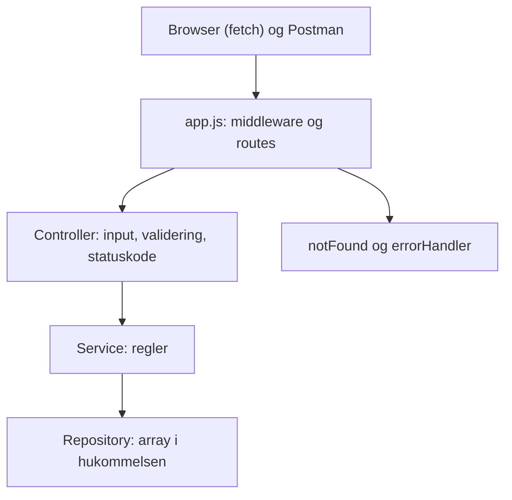

# Star Wars API (Jedi Data Archives)

## Hvad laver programmet?

En Express server med et REST API, der kan oprette, hente, erstatte og slette Star Wars karakterer, og en simpel hjemmeside, der henter og viser dem med `fetch()`. Karaktererne ligger i en array i hukommelsen, så de forsvinder, når serveren genstartes.

## Kom i gang

```bash
npm install
npm start
```

Åbn derefter `http://localhost:3000` i browseren. Kør tests og lint med `npm run check`.

## API

Udfyldes, efterhånden som endpoints bliver lavet.

* GET `/characters`: hent alle
* GET `/characters/:id`: hent én
* POST `/characters`: opret
* PUT `/characters/:id`: erstat
* DELETE `/characters/:id`: slet
* GET `/download` og GET `/go-to-luke`

## Struktur

* `public/`: frontend (HTML og JavaScript, Bootstrap fra CDN)
* `src/app.js`: samler middleware og routes (`createApp`)
* `src/server.js`: opretter repository og starter serveren på port 3000
* `src/controllers/`: læser request, validerer input og vælger statuskode
* `src/services/`: regler for karakterer
* `src/repositories/`: gemmer karaktererne i en array
* `src/middleware/`: logging, 404 og fejlhåndtering
* `tests/`: automatiske tests
* `postman/`: eksporteret Postman Collection

Flere regler står i [AGENTS.md](AGENTS.md), test reglerne i [docs/unit-test-guide.md](docs/unit-test-guide.md), og en guide til opsætningen i [docs/setup-guide.md](docs/setup-guide.md).

## Arkitektur (issue 1)



Rækkefølgen i `app.js`: logger, `express.json()`, `express.static`, routes under `/characters`, `notFound`, `errorHandler`.

### Svar på opgavens spørgsmål

* **Hvor håndteres HTTP requests?** I controlleren. Den læser `req`, tjekker input og vælger statuskode. `app.js` kobler URL og metode til de rigtige funktioner.
* **Hvor gemmes karakterdata?** I repositoryet, i en array i hukommelsen.
* **Hvor placeres valideringen?** I controlleren, i funktionen `validateCharacter`. Det er input fra HTTP, og det giver 400. Så kan servicen regne med, at data er gyldigt.
* **Fordele:** Hvert lag har ét ansvar. Lagene kan testes hver for sig. Repositoryet kan skiftes til en fil eller en database uden at ændre service og controller. Strukturen kender vi fra To Do Taming.
* **Ulemper:** Til en lille opgave er servicen tynd og gør ikke meget mere end at give data videre og finde en karakter. Der er flere filer, end der strengt taget er brug for. Validering i controlleren kan ikke genbruges, hvis der kommer en anden indgang end HTTP. Karaktererne forsvinder, når serveren genstartes.

### Ansvarsfordeling

* `app.js`: samler middleware og routes
* Controller: HTTP, input, validering, statuskode og logning af fejl
* Service: reglerne (find karakter, giv besked, hvis den ikke findes)
* Repository: den eneste, der kender arrayet
* Middleware: logning, 404 og central fejlhåndtering

### Hvad fungerer godt

Det er nemt at se, hvor noget hører til, og tests kan bruge et nyt repository hver gang.

### Hvad vi ville ændre, hvis projektet voksede

Gemme data i en database, så kun repositoryet skal ændres. Tilføje login og rettigheder. Dele routes ud i egen mappe, hvis der kommer flere ressourcer end karakterer.

### Beslutninger

1. **Id'er:** tælleren ligger i repositoryet, og `add` giver id'et i én operation. Servicen læser ikke først alle karakterer for at finde et nyt id. Det samme gælder PUT og DELETE: de er én operation i repositoryet.
2. **Sprog i fejlbeskeder:** engelsk i API'et, dansk i frontenden.
3. **Validering:** en funktion `validateCharacter` i controlleren.

## Mit stykke (skriv under dit eget navn)

Hver skriver sit eget afsnit her i sin pull request: hvad blev lavet, hvilke fejl fandt jeg, og svar på de "undersøg" spørgsmål, der hører til mit issue.

### Nicki

**Issue 3: GET /characters/:id og karakterer i frontend**

Hvad jeg lavede:
* Repository: `getById` finder en karakter i arrayet
* Service: `getCharacterById` giver karakteren eller `null`
* Controller: `handleGetOne` laver id til tal og svarer 200, 404 eller 500
* Frontend: `loadCharacters()` henter `/characters` og viser en `<li>` pr. karakter
* Tests: repository og GET /characters/:id (200 og 404)

Fejl jeg fandt:
* `req.params.id` er tekst, så det skal laves til tal med `Number`, ellers finder man ingen karakter
* Jeg lavede ved en fejl funktioner til andre issues og fjernede dem igen
* Lint klagede over en ubrugt variabel i en test

Undersøg (Network fanen):
* Metode og URL: GET `/characters`
* Status: 200
* Body: JSON array med `id`, `name`, `role` og `planet`
* JSON til elementer: `response.json()` giver et array, `map` laver en `<li>` pr. karakter, og `replaceChildren` sætter dem ind. Vi bruger `textContent`, ikke `innerHTML`.

**Issue 4: POST /characters, validering og formular**

Hvad jeg lavede:
* Controller: `validateCharacter` tjekker navn (mindst 2 tegn), rolle (Jedi, Sith, Rebel eller Smuggler) og planet (ikke tom). Forkerte typer giver en fejlbesked og crasher ikke. `handleCreate` svarer 400 ved fejl og 201 med den nye karakter
* Service: `createCharacter` trimmer navn og planet og kopierer kun de tre felter, så klienten ikke selv kan vælge id
* Repository: `add` giver id'et med en tæller i én operation
* Frontend: formular med navn, rolle og planet. `createCharacter()` sender POST og viser serverens fejlbesked
* Tests: `validateCharacter`, `add` og POST /characters (201, trim, id fra klient ignoreres, 400)

Fejl jeg fandt:
* Mit første forslag til id var `Date.now()`, men to oprettelser i samme millisekund kan få samme id. Det blev til en tæller
* Valideringsfunktionerne lå først inde i `createCharacterController`, så `validateCharacter` ikke kunne eksporteres. De flyttede jeg ud
* Min første `handleCreate` gav aldrig et svar ved gyldigt input, så requesten hang

Undersøg (Network fanen):
* Metode og URL: POST `/characters`
* Headers: `Content-Type: application/json`, ellers kan `express.json()` ikke læse body
* Body: JSON med `name`, `role` og `planet`
* Svar: 201 med karakteren og det nye `id`, eller 400 med `{ "error": "..." }`
* Frontenden: `response.ok` tjekkes, og ved fejl vises `data.error` i den røde boks

**Issue 6: download og redirect**

Hvad jeg lavede:
* GET `/download` henter alle karakterer og sender dem som tekstfilen `characters.txt`, én linje pr. karakter. `res.attachment` får browseren til at hente filen i stedet for at vise den
* GET `/go-to-luke` svarer med en redirect til `/characters/1`
* Tests: download (200, filnavn, type og indhold) og redirect (302 og `Location`)

Undersøg (Network fanen):
* `/download`: svaret har headeren `Content-Disposition: attachment; filename="characters.txt"` og typen `text/plain`
* `/go-to-luke`: først status 302 med en `Location` header, derefter henter browseren `/characters/1` med et nyt GET og får 200

**Issue 7: Postman**

Hvad jeg lavede:
* En Postman Collection med 17 requests og 23 tests (`pm.test`), som kører mod den kørende server med `{{baseUrl}}`
* Dækker GET alle og én (200, 404), POST (201 og 400 for manglende navn, ugyldig rolle, manglende planet, tal som navn og ødelagt JSON), PUT og DELETE (200, 204, 404), ukendt route (404), `/download` (200) og `/go-to-luke` (redirect, ender på Luke)
* Request 10 tjekker, at ugyldige POST ikke ændrede data

Sådan kører man den:
* Start serveren med `npm start`, importér filen fra `postman/`, og kør den med Collection Runner. Genstart serveren før hver kørsel, så data er tilbage til de fire standardkarakterer
* Resultat: 23 af 23 tests bestået

### Gon

### Mat

Issue 2:
Hvad jeg lavet:
middleware:
- Lavet errorHandler middleware således at når programmet køres og noget fejler for vi en fejlbesked.
- errorHandler håndterer fejl i Express, logger dem og sender passende HTTP-fejlbeskeder (400 ved ugyldig JSON og 500 ved serverfejl).
- lavet logger middleware således at vi kan se hvad der sker i vores program.
- logger hver HTTP-forespørgsels metode og URL i konsollen og sender derefter forespørgslen videre med next().
- lavet notFound middleware således at vi får en 404 fejl hvis vi prøver at tilgå en route der ikke findes.
- notFound giver en 404 fejl hvis routen ikke kan tilgås.
Tests:
- lavet derudover også api.tests som alle fire er grønne.
- Jeg testede midlertidigt uden next() med en lokal HTTP-request i stedet for Postman: requesten ventede, indtil klienten afbrød den, og nåede ikke routen. next() er sat tilbage.

Refleksion over 400,404,500:
-400: Bad request, serveren forstår ikke requesten, typisk fordi den er ugyldig. Vi bruger det, når JSON ikke kan parses.
-404: Not found, serveren kan ikke finde det, der efterspørges. i koden er det typisk fordi id'et ikke findes i arrayet. Vi bruger det, når en karakter ikke findes.
-500: Internal server error, serveren fejler, typisk fordi der er en fejl i koden. Vi bruger det, når der sker en uventet fejl.


Issue 5:
Hvad jeg lavet:
-Repository: Tilføjet funktioner til at erstatte og slette karakterer efter ID.
-Service: Tilføjet håndtering af erstatning og sletning, hvor URL’ens ID bevares.
-Controller: Implementeret PUT med validering og svarene 200/400/404 samt DELETE med 204/404.

Tests:
lavet tests for PUT (200, 404, 400) og DELETE (204, 404). som alle er grønne.

Refleksion over hvad der sker med karakter når server genstartes:
Karaktererne ligger kun i en array i serverens hukommelse, ikke i en database eller fil. Når serveren genstartes, nulstilles ændringer fra POST, PUT og DELETE: nye karakterer forsvinder, ændrede går tilbage til standardværdierne, og slettede standardkarakterer kommer tilbage.

## Tests

Kort beskrivelse af de tests, der er lavet.

## Kode review (issue 8)

* Tre forbedringsforslag og hvilken vi gennemførte
* AI review: hvilke forslag accepterede vi, hvilke afviste vi, og hvorfor

## Refleksionsspørgsmål

### 1. Hvilken arkitektur har I valgt, og hvorfor?

### 2. Hvad ville I ændre, hvis applikationen skulle bruges af mange brugere?

### 3. Hvilke fejl fandt I under udvikling og test?

### 4. Hvilken forbedring gennemførte I efter kode review?

### 5. Hvad lærte I om samspillet mellem frontend og backend?
